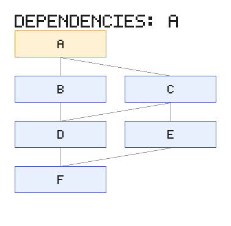
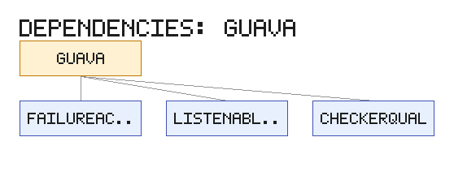

# Практика 4

Вариант №3: инструмент визуализации графа зависимостей для менеджера
пакетов. Формат пакетов — Java (Maven). Готовые средства (менеджеры
пакетов, сторонние библиотеки) для получения зависимостей не
используются — граф строится собственным кодом.

**Реализованы все пять этапов:**

| Этап | Что делает |
|------|------------|
| 1 | Конфигурация из командной строки, печать «ключ — значение» |
| 2 | Загрузка Maven POM по HTTP: `parent`, `dependencyManagement`, BOM |
| 3 | Обход графа в ширину, фильтр по подстроке, обрыв циклов |
| 4 | Обратные зависимости: кто зависит от заданного пакета |
| 5 | ASCII-дерево, список, Graphviz `.dot`, PNG |

Инструменты: Python 3.9+ (проверено на 3.11), только стандартная
библиотека. Внешних зависимостей нет. Graphviz (`dot`) используется,
если установлен; иначе PNG рисуется встроенным рендером.

---

## Как запустить

```bash
cd pr_4

# Тестовый репозиторий (без сети)
PYTHONPATH=src python3 -m depviz --package A \
    --repo test_repo/sample.txt --test-repo --ascii-tree -o graph.png

# Обратные зависимости
PYTHONPATH=src python3 -m depviz --package F \
    --repo test_repo/sample.txt --test-repo --reverse --ascii-tree

# Реальный Maven-репозиторий (нужна сеть)
PYTHONPATH=src python3 -m depviz \
    --package com.google.guava:guava --package-version 32.1.2-jre

# Справка и версия
PYTHONPATH=src python3 -m depviz --help
PYTHONPATH=src python3 -m depviz --version
```

Из корня репозитория:

```bash
./run.sh test      # юнит-тесты
./run.sh style     # проверка стиля по критериям
./run.sh check     # всё вместе
./run.sh -p A -r pr_4/test_repo/sample.txt -t --ascii-tree
```

## Параметры командной строки

| № | Параметр задания | Опция | По умолчанию |
|---|------------------|-------|--------------|
| 1 | Имя пакета | `-p, --package <имя>` | обязательно |
| 2 | URL репозитория или путь к файлу | `-r, --repo <URL\|путь>` | `https://repo.maven.apache.org/maven2` |
| 3 | Режим тестового репозитория | `-t, --test-repo` / `--real-repo` | реальный |
| 4 | Версия пакета | `-v, --package-version <вер>` | `latest` |
| 5 | Имя файла с изображением | `-o, --output <файл>` | `graph.png` |
| 6 | Вывод ASCII-деревом | `--ascii-tree` / `--no-ascii-tree` | список |
| 7 | Подстрока фильтра | `-f, --filter <подстрока>` | нет фильтра |

Дополнительно:

| Опция | Назначение |
|-------|------------|
| `-d, --max-depth <число>` | предельная глубина обхода (0..100, по умолчанию 100) |
| `--reverse` / `--no-reverse` | обратные зависимости (этап 4) |
| `-h, --help` | справка |
| `-V, --version` | версия приложения |

`--output` принимает `.png` (картинка) и `.dot` (исходник Graphviz).

---

## Этап 2: загрузка POM

Maven хранит артефакты по пути:

```
groupId/artifactId/version/artifactId-version.pom
```

Модуль `maven.py` делает следующее:

1. **Разрешает версию.** Если задана `--package-version` — берётся она.
   Если `latest` — читается `maven-metadata.xml` и выбирается последняя
   стабильная версия (без `-SNAPSHOT`).
2. **Загружает POM** по собранному URL с кешированием.
3. **Читает прямые зависимости** из `<dependencies>`.
4. **Подставляет `${...}`** из `<properties>`.
5. **Идёт по цепочке `<parent>`** (до 10 уровней) и собирает версии
   из `<dependencyManagement>` каждого родителя.
6. **Отбрасывает `test` и `provided`** — они не входят в граф
   зависимостей при сборке.

Версия зависимости ищется в порядке: явная у `<dependency>` →
`dependencyManagement` своей цепочки → пустая (артефакт без версии).

Сетевой слой (`http_client.py`) делает до 3 попыток с нарастающей
паузой, различает 404 (фатально) и 429/5xx (повтор), таймаут 30 с.
Все сетевые ошибки превращаются в понятный текст:

```
depviz: ошибка загрузки com.google.guava:guava:32.1.2-jre:
https://repo.maven.apache.org/maven2/.../guava-32.1.2-jre.pom:
не удалось подключиться: ... (попыток: 3)
```

## Этап 3: обход графа

Обход в ширину (BFS) с явной очередью, без рекурсии (`graph.py`):

* очередь хранит пары `(пакет, глубина)`;
* словарь `expanded` помнит минимальную глубину раскрытия вершины —
  повторный заход на такой же или большей глубине пропускается, это
  и обрывает циклы;
* `--max-depth` ограничивает раскрытие;
* `--filter` убирает пакеты, в имени которых есть подстрока;
* ошибка загрузки **корневого** пакета фатальна, у остальных она
  превращается в предупреждение в `stderr`, и пакет считается листом.

Тестовый репозиторий (`testrepo.py`) читает файл вида:

```
A -> B, C
B -> D
D ->
```

Имена — заглавные латинские буквы, `#` — комментарий. Ошибки формата
(нет стрелки, строчные буквы, повтор пакета) сообщаются с номером строки.

## Этап 4: обратные зависимости

При `--reverse` обход идёт по инвертированным рёбрам: начиная с
заданного пакета, для каждой вершины заново просматриваются все пакеты
репозитория и выясняется, кто от неё зависит. Глубина ограничивает
длину цепочки «кто зависит».

```
$ depviz -p F -r test_repo/sample.txt -t --reverse --ascii-tree
F
├── D
│   ├── B
│   │   └── A
│   └── C
│       └── A
└── E
    └── C
        └── A
```

## Этап 5: вывод

Три представления плюс файлы:

* **список** (по умолчанию): `пакет -> зависимости` и сводка
  «Вершин / Рёбер»;
* **ASCII-дерево** (`--ascii-tree`) от корня, ветки `├──` `└──`,
  узел, уже стоящий среди предков, помечается `(цикл)`;
* **Graphviz `.dot`** — `--output graph.dot`;
* **PNG** — `--output graph.png`.

PNG создаётся так:

1. если в системе есть `dot` (пакет Graphviz), вызывается
   `dot -Tpng` — результат как у штатных средств;
2. иначе включается **встроенный рендер**: раскладка по уровням,
   прямоугольники вершин, рёбра по Брезенхему, текст собственным
   растровым шрифтом 5×7 (`font.py`), кодирование PNG через
   `zlib` + `struct`.

Проверить наличие Graphviz:

```bash
dot -V
```

Установка: `apt install graphviz` (Debian/Ubuntu),
`brew install graphviz` (macOS), `choco install graphviz` (Windows).

Встроенный рендер даёт валидный PNG в любом случае — на скриншотах
ниже показан именно он.



Длинные имена обрезаются с `..`:



---

## Архитектура

```
pr_4/
├── src/depviz/
│   ├── __init__.py     описание пакета
│   ├── __main__.py     запуск как python -m depviz
│   ├── app.py          этапы 2-5: связка модулей
│   ├── config.py       этап 1: параметры и проверки
│   ├── http_client.py  HTTP с повторами и таймаутом
│   ├── maven.py        этап 2: POM, parent, BOM
│   ├── graph.py        этапы 3-4: BFS и обратный обход
│   ├── testrepo.py     этап 3: тестовый репозиторий
│   ├── render.py       этап 5: список, дерево, dot, PNG
│   ├── font.py         растровый шрифт 5x7 для PNG
│   └── version.py      версия и описание
├── tests/
│   ├── test_config.py  параметры (22 теста)
│   ├── test_maven.py   разбор POM (13 тестов)
│   └── test_graph.py   обход и вывод (28 тестов)
├── test_repo/          файлы тестового репозитория
└── scripts/            проверки и демонстрации
```

## Проверки

```bash
cd pr_4
bash scripts/run_all.sh
# [PASS] стиль кода (P2, Ф1, Ц1, К1, M1, P3)
# [PASS] юнит-тесты конфигурации
# [PASS] параметры командной строки
#
# Итого: успешно 3, провалено 0
```

Итоги: **63 юнит-теста**, **35 проверок CLI**, **0 нарушений стиля**.

Демонстрация всех этапов:

```bash
bash scripts/os/linux/demo_stages.sh
```

### Проверка стиля

`scripts/check_style.py` проверяет критерии автоматической проверки работ:

| Критерий | Что проверяется |
|----------|-----------------|
| **P2** | длина строки ≤ 80 **байт** UTF-8 |
| **Ф1** | функция не длиннее 40 строк |
| **Ц1** | цикломическая сложность ≤ 10 |
| **К1** | нет комментариев `#` (вместо них docstring) |
| **И1** | имена переменных в `snake_case` |
| **M1** | нет магических чисел в сравнениях |
| **P3** | docstring у модуля, класса и функции |

Важно: **P2 считает байты, а не символы**. Русская буква в UTF-8
занимает 2 байта, поэтому строки с кириллицей разбиты на короткие
литералы через неявную конкатенацию.

## Коды возврата

| Код | Значение |
|-----|----------|
| `0` | Успех |
| `2` | Ошибка параметров командной строки |
| `1` | Ошибка получения данных (сеть, POM, файл) |

## Обработка ошибок

| Что сломано | Что видит пользователь |
|-------------|------------------------|
| Пустой `--package` | `имя пакета не должно быть пустым` |
| Пробел в имени пакета | `недопустимое имя пакета` |
| Битый `--repo` | `параметр --repo должен быть URL` |
| Нет файла тестового репо | `файл тестового репозитория не найден` |
| `--repo` — каталог | `является каталогом, а не файлом` |
| Пустая версия | `версия пакета не должна быть пустой` |
| `--output` не `.png`/`.dot` | `должно оканчиваться на .png или .dot` |
| Нет родительского каталога | `родительский каталог ... не существует` |
| `--max-depth abc` | `глубина обхода должна быть целым числом` |
| `--max-depth -1` | `не может быть отрицательной` |
| `--max-depth 1000` | `слишком велика (максимум 100)` |
| Пустой `--filter` | `не должна быть пустой` |
| Неизвестная опция | `неизвестный параметр: --bogus` |
| Опция без значения | `параметр --package требует значения` |
| Сеть недоступна | `не удалось подключиться ... (попыток: 3)` |
| POM не найден (404) | `POM не найден: group:artifact:version` |
| Битый XML | `некорректный XML` |
| Пакет не в тестовом репо | предупреждение, пакет = лист |
| Битый файл тестового репо | ошибка с номером строки |

## Ограничения

* `dependencyManagement` читается только из цепочки `parent` своего
  артефакта; импортированные BOM (`<scope>import</scope>`) не
  раскрываются отдельным запросом — в цепочке остаётся запись `import`.
* Не поддерживаются Maven-profiles и `${project.version}`
  за пределами `parent`.
* Обратный обход перебирает все пакеты репозитория, поэтому на больших
  репозиториях он медленнее прямого.
* Версии из `maven-metadata.xml` сортируются как строки, а не по
  semver — для учебной задачи этого достаточно.

## Источник задачи

Работа выполнена по референсу
[dvoynyk/Package-manager](https://github.com/dvoynyk/Package-manager)
(адаптация с NuGet на Maven). Инструменты Graphviz применяются через
`subprocess`; при их отсутствии работает встроенный рендер.
